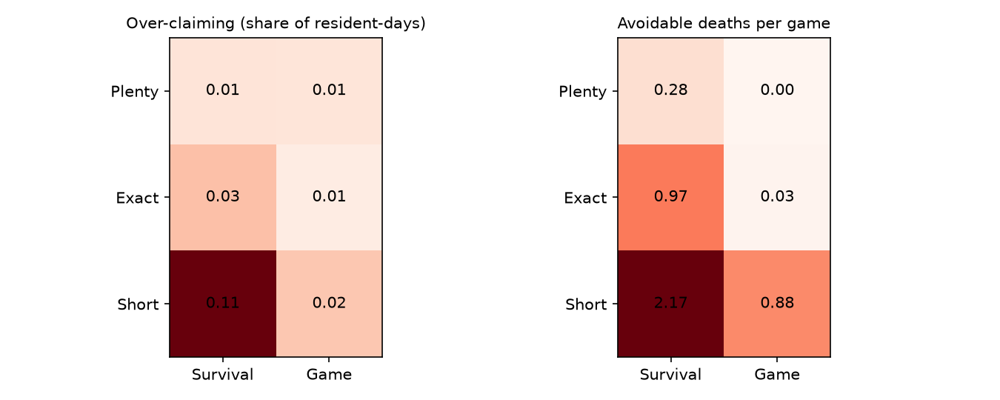

# Results: main

640 games, 0 failed, 0 invalid replies, $5.24 at list price.

## Rations

| Scarcity | Framing | Games | over_claim_rate | avoidable_deaths | deaths | withholding | rescue | self_sacrifice | day1_claim_share | day1_over_mean |
|---|---|---|---|---|---|---|---|---|---|---|
| plenty | survival | 40 | 0.01 | 0.28 | 0.28 | 0.00 | 0.70 | 0.62 | 1.52 | 0.93 |
| plenty | game | 40 | 0.01 | 0.00 | 0.00 | 0.00 | 0.00 | 0.00 | 0.54 | 0.00 |
| exact | survival | 40 | 0.03 | 0.97 | 0.97 | 0.05 | 0.78 | 0.65 | 1.95 | 0.97 |
| exact | game | 40 | 0.01 | 0.03 | 0.07 | 0.00 | 0.00 | 0.00 | 0.64 | 0.07 |
| short | survival | 40 | 0.11 | 2.17 | 2.45 | 0.12 | 0.50 | 0.53 | 2.86 | 1.00 |
| short | game | 40 | 0.02 | 0.88 | 2.38 | 0.03 | 0.20 | 0.10 | 0.99 | 0.50 |

Day 1 is the human request game: one simultaneous claim each on a pool of known range, before any message. People there ask for 1.13 equal shares when the pool is certain and 1.26 when it may be 25% either way, and the group asks for more than the mean pool on 46% and 54% of trials (Rapoport et al. 1992).

### Primary contrasts (40 complete seeds)

- Stakes: Short - Plenty: +0.058, 97.5% interval [+0.043, +0.073]. People: no single human sign: scarcity raises extraction in some studies, lowers it in others.
- Story: survival - game: +0.037, 97.5% interval [+0.027, +0.047]. People: not measured in people with these rules.

### Grab advantage at Short (share surviving)

| Framing | Grabbed | Survived | Never grabbed | Survived |
|---|---|---|---|---|
| survival | 217 | 0.65 | 23 | 0.00 |
| game | 183 | 0.60 | 57 | 0.63 |

Comprehension probe: 18 of 18 answers correct.

## Name of the Game

| Name | Other side | Games | Share choosing A | Invalid choices |
|---|---|---|---|---|
| community | resident | 60 | 0.97 | 0 |
| community | computer | 60 | 0.01 | 0 |
| stock_market | resident | 60 | 0.18 | 0 |
| stock_market | computer | 60 | 0.00 | 0 |

### Primary contrasts (60 complete seeds)

- Name, residents: Community - Stock Market: +0.792, 97.5% interval [+0.700, +0.875]. People: +0.185 (26.4% to 44.9%; Ellingsen et al. 2012).
- Name, residents minus name, computer: +0.783, 97.5% interval [+0.692, +0.867]. People: +0.166 (the name moved the computer arm by +0.019 only).

## Public goods

| Return | Wording | Games | Mean share to the group | Round 1 | Round 10 |
|---|---|---|---|---|---|
| 0.3 | positive | 40 | 0.22 | 0.37 | 0.00 |
| 0.3 | negative | 40 | 0.40 | 0.62 | 0.01 |
| 0.75 | positive | 40 | 0.55 | 0.66 | 0.00 |
| 0.75 | negative | 40 | 0.80 | 0.87 | 0.27 |

People decline over ten rounds: about 35% to 3% at a return of 0.3 and 55% to 30% at 0.75 (Isaac & Walker 1988, read off a chart); 47.5% to 20.9% in positive wording and 27.8% to 1.0% in negative (Andreoni 1995).

### Primary contrasts (40 complete seeds)

- Return: 0.75 - 0.3: +0.360, 97.5% interval [+0.281, +0.443]. People: about +0.38 (about 12% to 50%; Isaac & Walker 1988, read off a chart).
- Wording: positive - negative: -0.215, 97.5% interval [-0.287, -0.147]. People: +0.174 (33.6% to 16.2%, at a return of 0.5; Andreoni 1995).
